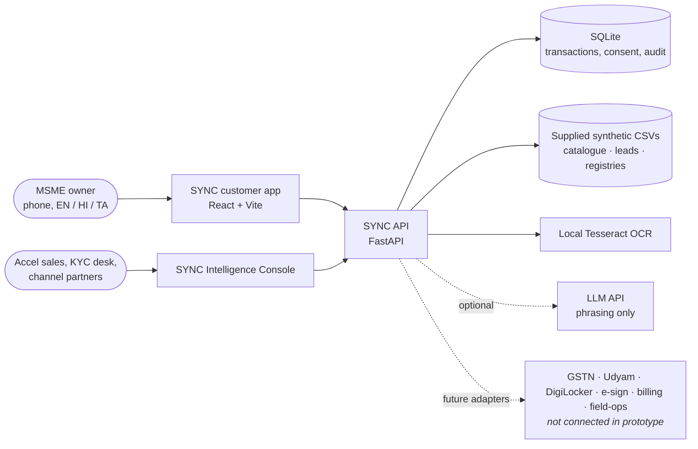
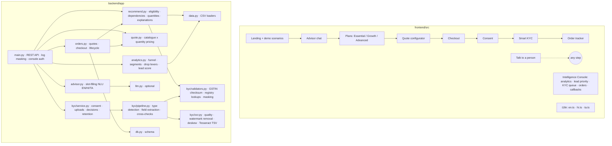
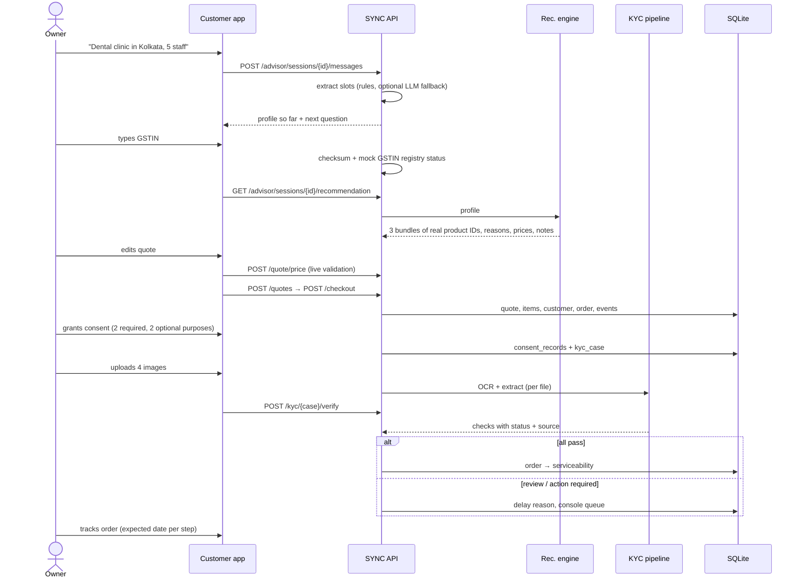
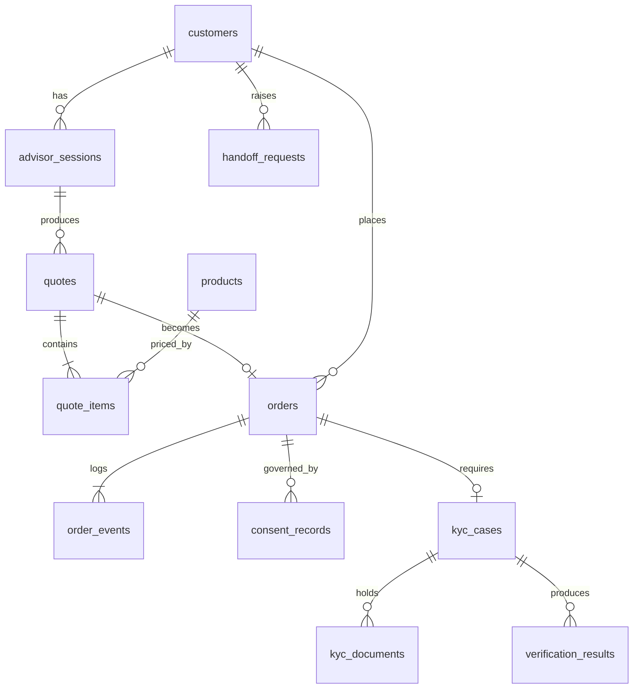
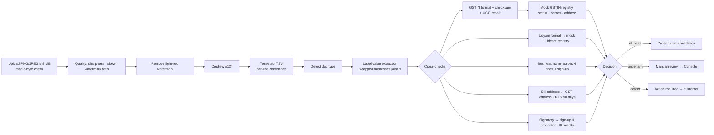

# SYNC Business – solution architecture

*From business discovery to digital activation in one seamless journey.*

## 1. System context

## 2. Components

## 3. Main data flow

## 4. API surface

| Area | Endpoints |
|---|---|
| Meta | `GET /api/health`, `GET /api/meta`, `GET /api/catalogue`, `GET /api/scenarios`, `POST /api/demo/reset` |
| Advisor | `POST /api/advisor/sessions`, `GET /api/advisor/sessions/{id}`, `POST …/{id}/messages`, `PUT …/{id}/profile`, `GET …/{id}/recommendation`, `POST /api/recommend` |
| Quote | `POST /api/quote/price` (live, validates), `POST /api/eligibility`, `POST /api/quotes`, `GET /api/quotes/{id}` |
| Order | `POST /api/checkout`, `GET /api/orders/{id or number}`, `POST /api/orders/{id}/advance` (demo) |
| Consent | `GET /api/consent/notice`, `POST /api/orders/{id}/consent`, `POST /api/orders/{id}/consent/withdraw` |
| KYC | `GET /api/kyc/specimens`, `POST /api/kyc/{case}/documents` (multipart), `POST /api/kyc/{case}/specimen`, `POST /api/kyc/{case}/verify`, `GET /api/kyc/{case}`, `GET …/documents/{doc}/image` |
| Lookups | `POST /api/lookup/gstin`, `POST /api/lookup/udyam` (POST so identifiers never appear in URLs or access logs) |
| Help | `POST /api/handoff` |
| Console (header `X-Console-Key`) | `GET /api/console/overview`, `/leads`, `/live`, `/kyc`, `POST /api/console/kyc/{case}/decision`, `GET /api/console/orders`, `GET/PATCH /api/console/handoffs` |

Interactive docs: `http://localhost:8000/docs`.

## 5. Database

`products` is seeded from the CSV on start (read-only copy for referential integrity). `audit_log` records consent grants/withdrawals, KYC decisions (with reviewer and reason) and checkouts. `quote_items.quantity` has a CHECK constraint (1-500).

## 6. AI architecture

| Layer | Implementation | Can it change products or prices? |
|---|---|---|
| Understanding | Rule-based slot filling with EN/HI/TA keyword lexicons, number/city/GSTIN/Udyam/budget regexes; every message scanned for every slot | No |
| Optional LLM fallback | If no slot is found and `ANTHROPIC_API_KEY` is set: JSON extraction constrained to allowed values, then validated | No |
| Decision | `recommend.py`: hard eligibility → connectivity fallback chain per segment/level → stated needs → segment add-ons → dependency repair → pricing | Yes, deterministically |
| Evidence | Historical attach rates per segment shown in reasons (e.g. "41% of similar businesses that activated with us chose it" for backup in professional offices) | No |
| Explanation | Template summary; optional LLM rephrases the already-chosen bundle in the user's language using only the facts passed | No |
| Lead score | Naive-Bayes log-odds, time-split backtest, compliance guardrail, protected attributes excluded | Ranks leads only |

## 7. KYC architecture

## 8. Security boundaries

| Boundary | Prototype control | Production requirement |
|---|---|---|
| Browser ↔ API | Same origin in demo; CORS allow-list; Pydantic validation and length limits on every input | TLS, WAF, rate limiting, OTP-verified sessions |
| Console | Shared header key `SYNC_CONSOLE_KEY` | SSO + RBAC (sales, KYC desk, partner scopes), per-partner data partitioning |
| Uploads | Type by magic bytes, 8 MB cap, random server-side filename, never the user's filename | Malware scan, encryption at rest (KMS), object storage with signed URLs |
| Identifiers | Masked in API responses, chat bubbles and logs (log filter) | Tokenisation vault |
| External registries | Not called; local mock CSVs | Licensed GSP / Udyam / DigiLocker APIs behind an adapter with consent artefacts |
| LLM | Off by default; receives no identifiers (profile facts and product names only) | DPA with provider, India data residency, prompt logging policy |
